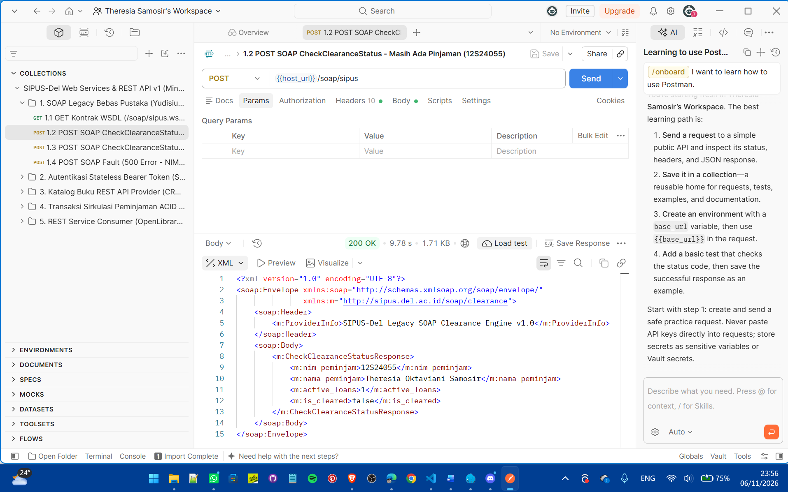
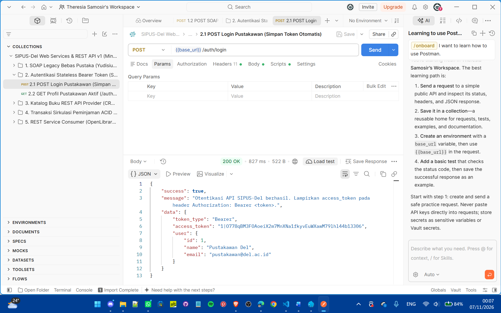
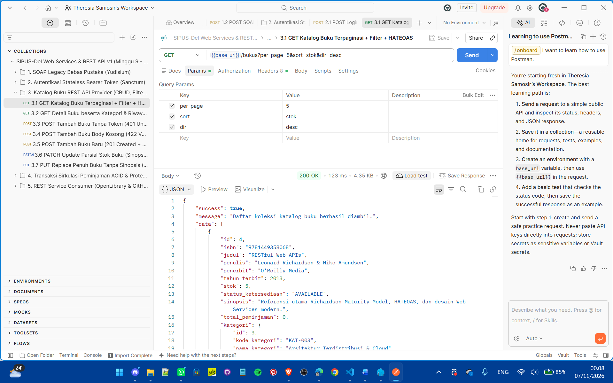
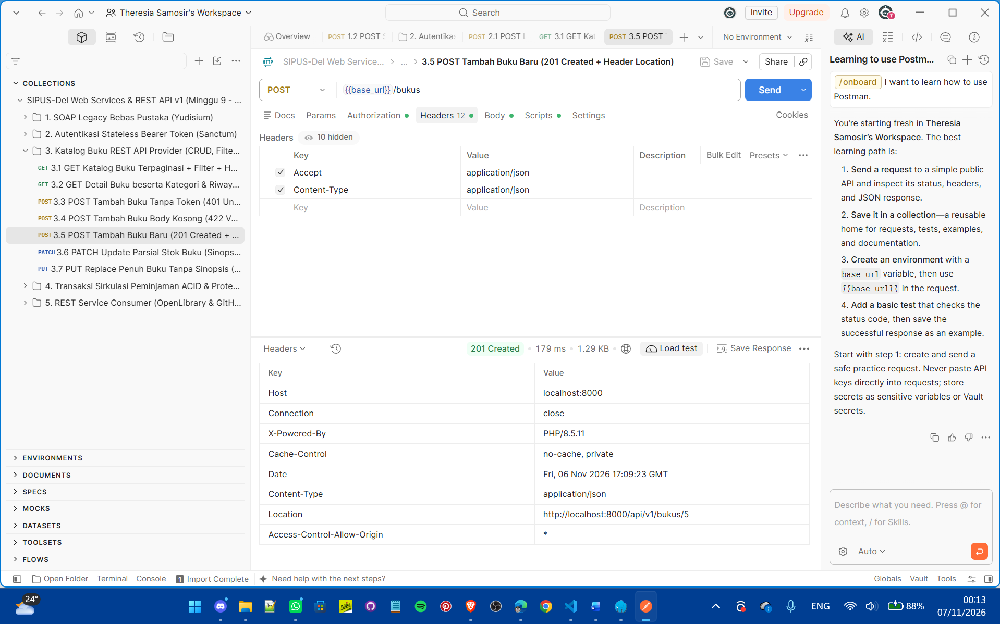
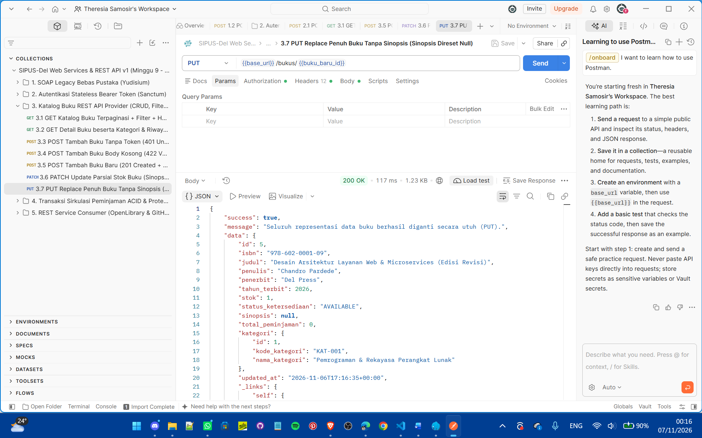
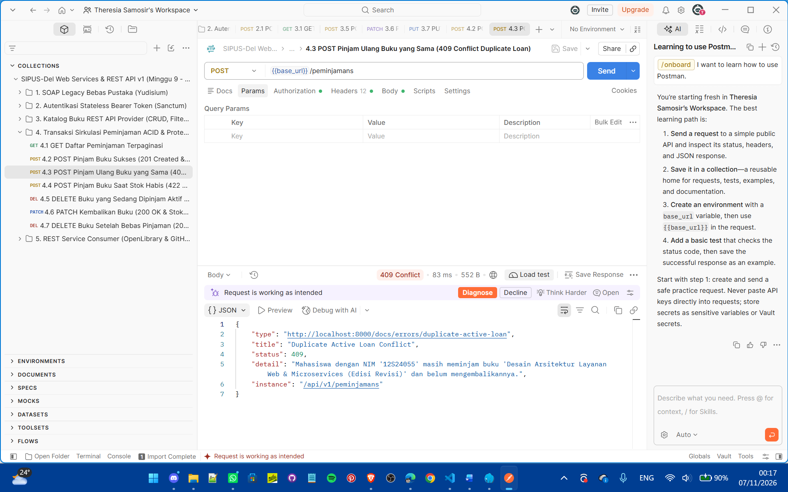
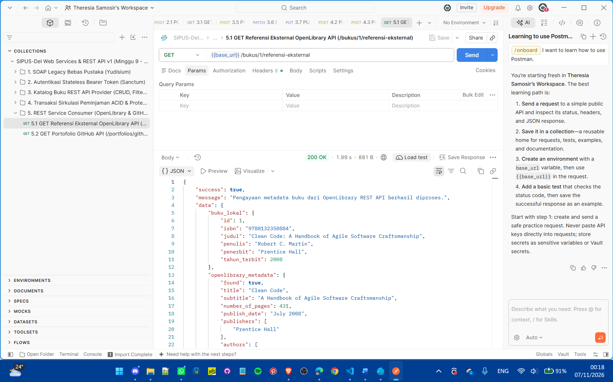

# SIPUS-Del (Sistem Informasi Perpustakaan Kampus Del) - Tahap 3
**Modul Praktikum Pemrograman dan Pengujian Aplikasi Web (12S3101) - Minggu 09: Arsitektur Web Services (SOAP & RESTful API v1)**

## 1. Identitas Mahasiswa
| Atribut | Keterangan |
| :--- | :--- |
| **Nama Lengkap** | Theresia Oktaviani Samosir |
| **NIM** | 12S24055 |
| **Program Studi** | S1 Sistem Informasi - Fakultas Informatika dan Teknik Elektro |
| **Institusi** | Institut Teknologi Del, Laguboti |
| **Branch Pengerjaan** | `week9-rest-api` |

## 2. Analisis Kebutuhan & Kelayakan (Feasibility) Web Services pada SIPUS-Del

Pada pengembangan Tahap 1 dan Tahap 2 (Minggu 5–6), **SIPUS-Del** beroperasi sebagai aplikasi web monolitik berorientasi manusia (*Human-to-Machine*) yang merender halaman HTML + CSS melalui Blade (`routes/web.php`) dan menjaga *state* pustakawan menggunakan *Session Cookie* (`HttpOnly`). Memasuki Tahap 3 (Minggu 9), UPT Perpustakaan IT Del harus terhubung dengan tiga ekosistem eksternal yang dibangun menggunakan platform berbeda, sehingga arsitektur wajib diperluas menuju komunikasi antar-mesin (*Machine-to-Machine* / M2M) berbasis **Web Services**.

### A. Pemetaan Peran Arsitektur: *Service Provider* vs *Service Consumer*
| Modul / Fungsionalitas Sistem | Peran SIPUS-Del | Mitra / Sistem Lawan Bicara | Protokol & Format | Rasionalisasi Bisnis & Kepemilikan Domain (*Domain Focus*) |
| :--- | :--- | :--- | :--- | :--- |
| **Verifikasi Bebas Pustaka Yudisium** (`CheckClearanceStatus`) | **SOAP Service Provider** | Sistem Administrasi Yudisium Kampus (*Legacy Enterprise*) | SOAP 1.1 over HTTP (`text/xml` + Kontrak `.wsdl`) | Data sirkulasi pinjaman aktif (`peminjamans`) adalah domain otoritatif milik SIPUS-Del. Karena sistem Yudisium warisan masih mengandalkan *Client Stub* berbasis WSDL, SIPUS-Del menyediakan endpoint SOAP ringkas agar sistem lama dapat memverifikasi tanggungan buku mahasiswa tanpa merombak kode intinya. |
| **Layanan Katalog & Sirkulasi Perpustakaan** (`/api/v1/bukus` & `/api/v1/peminjamans`) | **REST API Provider** | Aplikasi Mobile Mahasiswa (Flutter/Kotlin) & Mesin Kiosk Mandiri Perpustakaan | RESTful HTTP/JSON (`application/json` + `application/problem+json`) | SIPUS-Del bertindak sebagai *Single Source of Truth* atas stok buku dan transaksi peminjaman ACID. Mengekspos endpoint REST nir-status (*stateless*) memungkinkan aplikasi Mobile dan Kiosk memproses peminjaman secara *real-time* tanpa duplikasi logika bisnis. |
| **Pengayaan Metadata Bibliografi Internasional** (`/api/v1/bukus/{id}/referensi-eksternal`) | **REST API Consumer** | **OpenLibrary REST API** (`https://openlibrary.org/api/books`) | RESTful HTTPS Client (`Laravel Http Facade`) | Menyimpan jutaan metadata buku dunia (jumlah halaman, sampul buku, tautan pratinjau) di database lokal SIPUS-Del tidak layak secara biaya dan penyimpanan. SIPUS-Del cukup memanggil OpenLibrary API berdasarkan ISBN saat detail buku diminta. |

### B. Analisis Kelayakan Teknis: Mengapa Memilih REST API (JSON) dibanding SOAP (XML) untuk Mobile & Kiosk?
1. **Efisiensi Payload & Bandwidth Jaringan**: Pesan SOAP mewajibkan bungkusan `<soap:Envelope>`, `<soap:Header>`, dan `<soap:Body>` beserta deklarasi *XML Namespace* yang berukuran ratusan hingga ribuan *byte* bahkan untuk mengirim satu parameter sederhana. Sebaliknya, representasi JSON pada REST API berukuran **5–8 kali lebih ringkas**, menghemat kuota data seluler mahasiswa dan mempercepat waktu muat pada jaringan kampus.
2. **Kinerja Parsing di Perangkat Klien (CPU & Baterai)**: Aplikasi ponsel (Android/iOS) dan perangkat Kiosk memproses objek JSON secara *native* tanpa memerlukan *XML DOM/SAX Parser* yang berat di memori dan menguras baterai perangkat.
3. **Skalabilitas Horizontal melalui Sifat *Stateless* (Nir-Status)**: Dengan menerapkan autentikasi `Authorization: Bearer <token>` (Laravel Sanctum) tanpa menyimpan sesi di memori server (*Zero Server Session*), beban trafik API saat periode puncak peminjaman awal semester dapat dibagi rata ke banyak server di belakang *Load Balancer*.
4. **Pemanfaatan Semantik Alami HTTP & Hypermedia (RMM Level 3)**: REST memanfaatkan langsung metode HTTP (`GET`, `POST`, `PUT`, `PATCH`, `DELETE`), kode status (`200`, `201`, `204`, `401`, `404`, `409`, `422`), serta navigasi dinamis **HATEOAS (`_links`)**. Klien Mobile/Kiosk dapat langsung mengetahui apakah tombol *"Pinjam Buku"* atau *"Kembalikan Buku"* boleh ditampilkan cukup dengan memeriksa keberadaan tautan aksi di dalam `_links` tanpa menduplikasi rumus bisnis backend.

## 3. Tabel Katalog Endpoint Web Services (SOAP & REST API v1)

| No | Method | URI Endpoint | Proteksi Auth | Deskripsi Layanan & Perilaku Bisnis | Kode Status Respons |
| :---: | :---: | :--- | :---: | :--- | :--- |
| **1** | `GET` | `/soap/sipus.wsdl` | Publik | Menyajikan dokumen kontrak formal XML WSDL untuk operasi `CheckClearanceStatus`. | `200 OK` (`text/xml`) |
| **2** | `POST` | `/soap/sipus` | Publik (M2M) | Menerima `<soap:Envelope>` berisi `<nim_peminjam>`, menghitung pinjaman aktif (`status = 'dipinjam'`), dan mengembalikan `<active_loans>` serta `<is_cleared>`. | `200 OK` / `500 SOAP Fault` |
| **3** | `POST` | `/api/v1/auth/login` | Publik | Memverifikasi email & password pustakawan dan menerbitkan Sanctum Bearer Token (`plainTextToken`). | `200 OK` / `401` / `422` |
| **4** | `GET` | `/api/v1/auth/me` | `Bearer Token` | Mengambil profil pustakawan pemilik token yang sedang aktif. | `200 OK` / `401` |
| **5** | `POST` | `/api/v1/auth/logout` | `Bearer Token` | Mencabut (*revoke*) token akses aktif dari tabel `personal_access_tokens`. | `200 OK` / `401` |
| **6** | `GET` | `/api/v1/bukus` | Publik | Daftar buku terpaginasi lengkap dengan `meta` & `_links` HATEOAS (`?search=`, `?kategori_id=`, `?tersedia=1`, `?sort=`). Bebas *N+1 query*. | `200 OK` |
| **7** | `GET` | `/api/v1/bukus/{id}` | Publik | Detail satu buku (berdasarkan ID atau ISBN) beserta objek kategori, riwayat peminjaman, & `_links` HATEOAS. | `200 OK` / `404` |
| **8** | `POST` | `/api/v1/bukus` | `Bearer Token` | Menambah buku baru ke katalog dengan validasi ketat dan mengembalikan header `Location: /api/v1/bukus/{id}`. | `201 Created` / `401` / `422` |
| **9** | `PUT` | `/api/v1/bukus/{id}` | `Bearer Token` | *Full Replacement*: Mengganti seluruh atribut buku secara utuh (atribut nullable `sinopsis` direset ke `null` jika tidak dikirim). | `200 OK` / `404` / `422` |
| **10** | `PATCH` | `/api/v1/bukus/{id}` | `Bearer Token` | *Partial Update*: Memperbarui sebagian atribut buku (`sometimes|required`, misal hanya mengubah `stok`). | `200 OK` / `400` / `404` / `422` |
| **11** | `DELETE` | `/api/v1/bukus/{id}` | `Bearer Token` | Menghapus buku (ditolak `409 Conflict` jika masih ada peminjaman berstatus `'dipinjam'`). | `204 No Content` / `404` / `409` |
| **12** | `GET` | `/api/v1/bukus/{id}/referensi-eksternal` | Publik | *REST Consumer*: Memanggil OpenLibrary API (`Http::timeout(8)`) berdasarkan ISBN buku beserta *fallback* aman. | `200 OK` / `404` / `502` / `504` |
| **13** | `GET` | `/api/v1/peminjamans` | `Bearer Token` | Daftar transaksi sirkulasi terpaginasi dengan filter `?status=dipinjam\|dikembalikan` dan `?nim=...`. | `200 OK` / `401` |
| **14** | `POST` | `/api/v1/peminjamans` | `Bearer Token` | Mencatat peminjaman baru di dalam `DB::transaction()` + `lockForUpdate()`. Menolak stok habis (`422`) & pinjaman ganda (`409`). | `201 Created` / `409` / `422` |
| **15** | `PATCH` | `/api/v1/peminjamans/{id}/kembalikan` | `Bearer Token` | Mengembalikan buku secara atomik (`DB::transaction()` + `lockForUpdate()`), mengisi `tanggal_kembali`, & menambah stok (`+1`). | `200 OK` / `404` / `409` |
| **16** | `GET` | `/api/v1/portfolios/github/{username}` | Publik | *REST Consumer (Lab 2)*: Orkestrasi profil & 3 repositori terbaru dari GitHub REST API. | `200 OK` / `404` / `502` |

## 4. Panduan Instalasi & Pengujian Cepat

### A. Persiapan Lingkungan & Database Seeder
```bash
# 1. Masuk ke direktori proyek dan instal dependensi Composer
composer install

# 2. Salin konfigurasi environment dan buat kunci aplikasi
cp .env.example .env
php artisan key:generate

# 3. Jalankan migrasi tabel (termasuk personal_access_tokens) beserta DatabaseSeeder
php artisan migrate:fresh --seed

# 4. Nyalakan server pengembangan lokal
php artisan serve
```

### B. Kredensial Akun Uji Pustakawan (Seeder Lokal)
Gunakan akun berikut pada endpoint `POST /api/v1/auth/login` maupun antarmuka Web Blade (`/login`):
* **Email**: `pustakawan@del.ac.id`
* **Password**: `password123`

### C. Cara Mengimpor Kontrak OpenAPI 3.0 & Koleksi Postman
1. **Koleksi Postman Siap Pakai**: Buka aplikasi **Postman Desktop**, klik **Import**, lalu pilih berkas `docs/SIPUS-Del-API-v1.postman_collection.json`.
   * Koleksi ini sudah dilengkapi variabel `{{base_url}}` (`http://localhost:8000/api/v1`) dan *Test Script* otomatis pada request **2.1 POST Login Pustakawan** yang langsung menyimpan `access_token` ke dalam variabel `{{token}}`.
2. **Kontrak OpenAPI 3.0 (Swagger)**: Buka berkas `docs/openapi-sipus-v1.yaml` atau tempelkan isinya ke [Swagger Editor](https://editor.swagger.io) untuk melihat dokumentasi interaktif seluruh skema dan endpoint.

## 5. Galeri Bukti Pengujian (Screenshots)

Simpan hasil tangkapan layar (*screenshot*) pengujian Postman Anda ke dalam folder `screenshots/week9/` sesuai daftar 7 skenario wajib pada Modul Minggu 9 Poin 5.3.5:

1. **Uji SOAP XML & `<soap:Fault>`** (`POST /soap/sipus` — Skenario sukses `<is_cleared>` & skenario error `<soap:Fault>`)
   
2. **Login Sanctum Bearer Token** (`POST /api/v1/auth/login` — Penerbitan `access_token` untuk `pustakawan@del.ac.id`)
   
3. **GET Katalog Buku Terpaginasi + HATEOAS Dinamis** (`GET /api/v1/bukus` — Menampilkan blok `meta` dan tautan `_links.pinjam_buku` yang hanya muncul saat `stok > 0`)
   
4. **POST Buku Baru `201 Created` + Header `Location`** (`POST /api/v1/bukus` — Menampilkan status `201 Created` dan header `Location: http://localhost:8000/api/v1/bukus/{id}`)
   
5. **Bukti Perbedaan Semantik `PUT` vs `PATCH`** (`PATCH /api/v1/bukus/{id}` hanya mengubah `stok` tanpa menghapus `sinopsis`, sedangkan `PUT /api/v1/bukus/{id}` tanpa `sinopsis` mereset `sinopsis` menjadi `null`)
   
6. **Transaksi Sirkulasi Peminjaman Sukses (`201`) & Penolakan Stok Habis / Duplikat (`422` / `409` RFC 7807)** (`POST /api/v1/peminjamans`)
   
7. **Bukti Latihan Konsumsi GitHub REST API & OpenLibrary API (Token Disensor!)** (`PATCH https://api.github.com/user` dengan token `ghp_************************************` disensor & `GET /api/v1/bukus/1/referensi-eksternal`)
   
